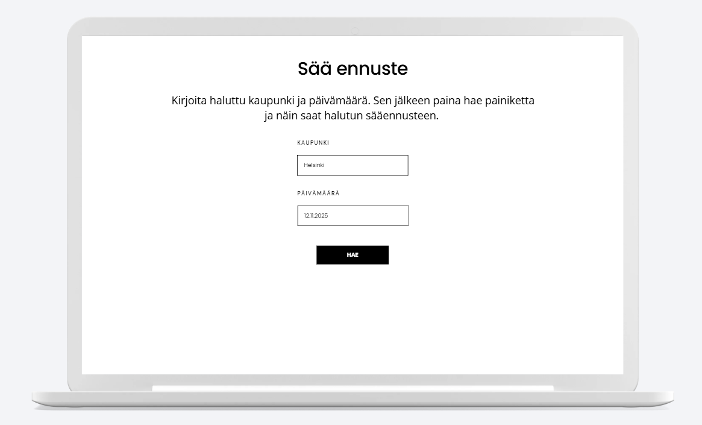
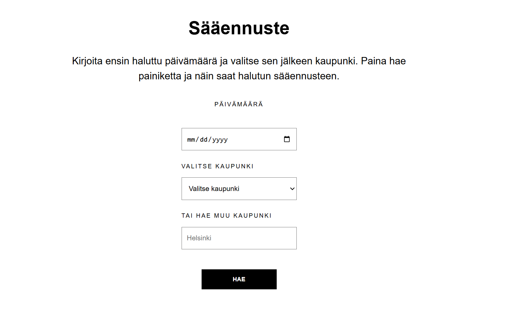

# Projektin nimi
Ennuste sää

**Tekijä(t):** Mette Holmström ja Jimi Helenius

## Projektisuunnitelma

### Projektin idea
Eri paikkakuntien sääennuste. Sovellus on tarkoitettu kaikille ihmisille, jotka
ovat kiinnostuneita tai halukkaita hakemaan sääennusteita. 

### Suunnitellut toiminnot

Toiminto 1: Kaupungin hakeminen - Käyttäjä voi kirjoittaa haluamanasa kaupungin nimen, jonka perusteella sovellus hakee sääennusteen. 
Toiminto 2: Päivämäärän valitseminen - Käyttäjä voi valita haluamansa päivämäärän ja tarkastella kyseisen päivän sääennustetta. 
Toiminto 3: Sääennusteen näyttäminen - Sovellus näyttää valitun kaupungin ja päivämäärän sääennusteen kolmen tunnin välein. Ennuste sisältää lämpötilan, sääolosuhteet, tuulen nopeuden ja ilmankosteuden.

### Rautalankamalli / luonnos

Rautalankamalli

## Verkkolinkit

- **Julkaistu sovellus:** https://me77e.github.io/Projekti_2/

- **GitHub-repositorio:** https://github.com/me77e/Projekti_2

- **Projektin videoesittely:** Lisää tähän videon osoite

## Tietoja sovelluksesta
Ennuste sää verkkosovelluksen tarkoituksena on tarjota käyttäjälle helppo tapa tarkastella eri kaupunkien sääennusteita. Käyttäjä voi syöttää haluamansa kaupungin ja valita päivämäärän, jonka jälkeen sovellus näyttää sääennusteen kolmen tunnin välein. Ennuste sisältää lämpötilan, sääolosuhteet, tuulen nopeuden ja ilmankosteuden.

## Teknologiat

HTML – Verkkosovelluksen rakenne ja lomakekentät.
CSS – Sivuston ulkoasu ja asettelu.
JavaScript – Sovelluksen toiminnallisuus, käyttäjän syötteiden käsittely ja sääennusteiden näyttäminen.
OpenWeatherMap API – Kaupunkien sijaintitietojen ja sääennusteiden hakeminen.

## Sovelluksen käyttö
Käyttäjä syöttää haluamansa kaupungin ja valitsee päivämäärän, jonka jälkeen hän painaa Hae-painiketta.

Sovellus hyödyntää OpenWeatherMap API -rajapintaa. Ensin sovellus hakee syötetyn kaupungin koordinaatit Geocoding API avulla. Tämän jälkeen se hakee koordinaattien perusteella sääennusteen Forecast API.

JavaScript käsittelee rajapinnasta saadut tiedot ja suodattaa ennusteet käyttäjän valitseman päivämäärän mukaan. Lopuksi sovellus näyttää sääennusteen kolmen tunnin välein sisältäen lämpötilan, sääolosuhteet, tuulen nopeuden ja ilmankosteuden.

Esimerkki kuvan lisäämisestä:

## Kuvakaappaus sovelluksesta

## Tunnetut virheet / puutteet
- Sääennusteen hakeminen onnistuu vain jos päivämäärän syöttää ensin. 
- Sääennusteen saa vain 5 päivää eteenpäin

## Työn jakautuminen
Projektia työstetty yhdessä. 

## Oma arvio ja oppimisen reflektointi
Pohdi työtäsi ja oppimisprosessiasi.

Missä onnistuin?
-Onnistuimme luomaan toimivan sovelluksen, joka tarjoaa käyttäjälle mahdollisuuden hakea haluamansa paikkakunnan sääennusteen.

Mikä oli haastavaa? 
-
Mitä parantaisin, jos aikaa olisi enemmän?

- 

Mitä opin HTML:stä, CSS:stä, JavaScriptistä ja DOM-skriptauksesta?
Oma arvio projektista: 8/10 pistettä

Lähteet ja kiitokset
Listaa kaikki projektissa käyttämäsi lähteet, tutoriaalit, kuvat ja koodiesimerkit.

Jos käytit ChatGPT:tä, GitHub Copilotia tai muuta tekoälytyökalua, mainitse se tässä ja kerro lyhyesti, miten se tuki työskentelyäsi.

## Lähteen tai tutoriaalin nimi

OpenWeatherMap API Tutorial 2021 https://www.youtube.com/watch?v=nGVoHEZojiQ&t=559s 

How to Use Weather API for Beginners | Open Weather Map API https://www.youtube.com/watch? v=MdIfZJ08g2I
 
Openweather Current & Forecast https://openweathermap.org/api/current?collection=current_forecast

Kuvalähde

Käytetty tekoälytyökalu: ...

Miten työkalua käytettiin: ...

## Lisenssi
Tämä projekti on lisensoitu MIT-lisenssillä.

Lisätietoa lisenssin lisäämisestä GitHub-projektiin: https://docs.github.com/en/communities/setting-up-your-project-for-healthy-contributions/adding-a-license-to-a-repository